# Composição das matrículas e transferências do FUNDEB: evidência contrafactual nas cinco regiões brasileiras

## Resumo

Este artigo testa, no motor completo do FUNDEB, se a composição das matrículas — e não apenas o total de alunos — altera os recursos simulados de municípios e estados. A amostra cobre 10 municípios de 10 unidades da federação, com ao menos um estado em cada uma das 5 regiões brasileiras. Em cada cenário, um percentual dos alunos de uma modalidade de menor peso é transferido para outra de maior peso (ou o inverso), conservando o total de matrículas do município. O simulador é reexecutado sobre todos os entes do país. Nos exercícios 2024, 2025, 2026 foram gerados 2641 cenários, todos aprovados pela validação interna do motor. No exercício 2026, a melhor transformação factível aumentou os recursos do município-alvo em 10 de 10 casos; o controle inverso reduziu-os em 10 de 10. O sinal segue a diferença de pesos. O ente estadual e os demais municípios da mesma UF absorvem parte do ajuste. A soma estadual só cresce de forma material quando a União complementar o fundo (VAAF/VAAT). Os resultados descrevem incentivos implícitos nos fatores de ponderação; não constituem recomendação para reclassificar alunos.

**Palavras-chave:** FUNDEB; matrícula ponderada; fatores de ponderação; VAAF; VAAT; estudo contrafactual; equalização federativa.

## Abstract

We test, in a full FUNDEB simulation engine, whether the composition of enrollments — holding the municipal headcount fixed — changes simulated transfers to municipalities and states. The sample comprises 10 municipalities in 10 states, covering all five Brazilian regions, over 2024, 2025, 2026. Counterfactual shifts from lower-weight to higher-weight modalities raise municipal resources in 10/10 cases in 2026; the reverse shift lowers them in 10/10. The state-level total rises only when the Union complements the fund. The article maps implicit incentives in weighting factors; it does not recommend reclassifying students.

**Keywords:** FUNDEB; weighted enrollment; VAAF; VAAT; counterfactual simulation.

## 1 Introdução

O Fundo de Manutenção e Desenvolvimento da Educação Básica e de Valorização dos Profissionais da Educação (FUNDEB) reparte recursos segundo matrículas ponderadas por etapa, modalidade e turno, e equaliza o valor aluno-ano entre entes (VAAF no âmbito estadual; VAAT no âmbito nacional). Segue da fórmula que dois municípios com o mesmo número de alunos podem receber montantes distintos se a composição das matrículas for diferente. A tese examinada aqui é mais estreita e operacional: *mantido constante o total de alunos de um município, uma reclassificação contrafactual entre modalidades de pesos distintos altera o que esse município — e o estado a que pertence — recebe no motor oficial do fundo?*

A pergunta não é normativa. Transferir alunos de turno parcial para integral, ou o inverso, tem custos pedagógicos, de infraestrutura e de jornada que este estudo não estima. O ótimo matemático (concentrar matrículas na etapa de maior peso) não é tratado como política. O objeto é o incentivo financeiro implícito nos fatores de ponderação: se o sinal do efeito é estável entre regiões, anos e sentidos da transferência, a composição deixa de ser um detalhe de planilha e passa a ser um parâmetro causal da alocação simulada.

Um estudo anterior, restrito a dez municípios do Ceará, já havia documentado ganhos municipais, quase-linearidade e spillover intraestadual. Restava saber se o mecanismo é local ou nacional: se capitais de UFs ricas e pobres, do Norte ao Sul, reproduzem o mesmo sinal, e se a União entra ou não no ajuste. Este artigo responde com uma amostra mínima que cruza as cinco macrorregiões.

## 2 Dados e método

### 2.1 Amostra e exercícios

Selecionaram-se 10 municípios — capitais e grandes redes — em 10 estados, com pelo menos um estado em cada região. Os códigos IBGE foram resolvidos no próprio dataset (município: IBGE > 100; nome oficial normalizado e UF), sem lista prévia de códigos. Os exercícios são 2024, 2025, 2026: o de 2024 vem dos arquivos legados do simulador; 2025 e 2026, das planilhas oficiais do ciclo correspondente. Cada ano é um snapshot completo, não uma série interpolada.

**Tabela 1.** Municípios da amostra (exercício 2026).

| regiao | uf | municipio | ibge |
| --- | --- | --- | --- |
| Centro-Oeste | GO | Goiânia | 5208707 |
| Nordeste | CE | Fortaleza | 2304400 |
| Nordeste | BA | Salvador | 2927408 |
| Norte | PA | Belém | 1501402 |
| Norte | AM | Manaus | 1302603 |
| Sudeste | MG | Belo Horizonte | 3106200 |
| Sudeste | RJ | Rio de Janeiro | 3304557 |
| Sudeste | SP | São Paulo | 3550308 |
| Sul | PR | Curitiba | 4106902 |
| Sul | RS | Porto Alegre | 4314902 |

**Tabela 2.** Baseline municipal no exercício 2026: matrículas totais, recursos FUNDEB e complementação da União recebida pelo ente.

| municipio | uf | regiao | total_matriculas | recursos_fundeb | complemento_uniao |
| --- | --- | --- | --- | --- | --- |
| Goiânia | GO | Centro-Oeste | 111.376 | R$ 932.820.950,35 | R$ 40.489.480,71 |
| Fortaleza | CE | Nordeste | 257.695 | R$ 2.236.072.546,41 | R$ 806.518.502,24 |
| Salvador | BA | Nordeste | 165.365 | R$ 1.207.172.890,91 | R$ 332.435.656,71 |
| Belém | PA | Norte | 67.574 | R$ 487.073.753,23 | R$ 159.245.729,98 |
| Manaus | AM | Norte | 252.213 | R$ 1.764.373.287,31 | R$ 324.669.764,08 |
| Belo Horizonte | MG | Sudeste | 198.058 | R$ 1.813.873.787,00 | R$ 0,00 |
| Rio de Janeiro | RJ | Sudeste | 638.915 | R$ 5.109.336.683,77 | R$ 0,00 |
| São Paulo | SP | Sudeste | 993.554 | R$ 8.296.643.118,86 | R$ 0,00 |
| Curitiba | PR | Sul | 128.419 | R$ 1.100.320.189,78 | R$ 0,00 |
| Porto Alegre | RS | Sul | 68.883 | R$ 704.435.923,24 | R$ 0,00 |

### 2.2 Desenho contrafactual

Quatro transições factíveis de turno, detectadas automaticamente pelos aliases de etapa de cada ano, formam a grade experimental: (A) creche parcial → integral pública; (B) pré-escola parcial → integral pública; (C) ensino fundamental, anos iniciais urbano → fundamental integral; (D) anos finais urbano → fundamental integral. Em 2024 o peso VAAF do fundamental integral é 1,40; em 2025–2026, 1,50. O peso dos anos iniciais urbanos permanece 1,00.

Para cada município, transição e percentual de 5% a 100% (passo 5), os alunos são movidos da origem para o destino. A conservação do total municipal e a não-negatividade são exigidas antes de cada simulação. O controle inverso faz o caminho oposto (integral → parcial/urbano) a 50% e 100% do estoque de destino. Em ambos os sentidos o headcount do município-alvo é idêntico ao baseline.

### 2.3 Motor, parâmetros e validação

Cada cenário reexecuta `simula_fundeb` sobre o universo de entes, não um produto local peso × aluno. Os parâmetros `max_nse = min_nse = max_nf = min_nf = 1,0` reproduzem o cenário de referência dos exercícios 2025–2026; em 2024 o NF interno é achatado para 1 após o reescalonamento do motor, persistindo o NSE oficial. O ponderador é NF em 2024 e DREC a partir de 2025. As complementações da União são as oficiais do dataset. Após cada corrida corre a validação interna (RF-10). Dos 2641 cenários, 2641 foram válidos.

As métricas reportadas são: variação absoluta e percentual de `recursos_fundeb` do município-alvo; variação dos demais municípios da mesma UF; variação do ente estadual (IBGE < 100); variação da soma da UF; e decomposição em VAAF próprio, complemento VAAF e complemento VAAT.

## 3 Resultados

### 3.1 O município-alvo ganha quando o peso sobe

No exercício 2026, a melhor transformação factível — em todos os 10 municípios, a transição C a 100% — aumentou `recursos_fundeb`. Nenhum ΔR$ foi negativo. A magnitude varia com o estoque elegível e com a posição da UF no mecanismo de equalização. Manaus concentra o extremo da amostra em ganho percentual e absoluto (40,58%; R$ 716.056.285,71). O menor ganho percentual da amostra ainda é positivo: Belo Horizonte, 4,98%.

**Tabela 3.** Melhor cenário factível por município (2026). Transição C a 100% em todos os casos. Valores em R$ milhões, salvo o Δ%.

| municipio | uf | regiao | alunos_movidos | base_mi | delta_mi | delta_r_percentual |
| --- | --- | --- | --- | --- | --- | --- |
| Goiânia | GO | Centro-Oeste | 38.253 | 932,8 | 113,4 | 12,16% |
| Fortaleza | CE | Nordeste | 28.837 | 2.236,1 | 233,9 | 10,46% |
| Salvador | BA | Nordeste | 66.612 | 1.207,2 | 203,8 | 16,88% |
| Belém | PA | Norte | 24.118 | 487,1 | 74,8 | 15,36% |
| Manaus | AM | Norte | 95.204 | 1.764,4 | 716,1 | 40,58% |
| Belo Horizonte | MG | Sudeste | 27.446 | 1.813,9 | 90,3 | 4,98% |
| Rio de Janeiro | RJ | Sudeste | 126.493 | 5.109,3 | 328,7 | 6,43% |
| São Paulo | SP | Sudeste | 186.962 | 8.296,6 | 537,7 | 6,48% |
| Curitiba | PR | Sul | 38.959 | 1.100,3 | 118,6 | 10,78% |
| Porto Alegre | RS | Sul | 14.044 | 704,4 | 54,2 | 7,70% |

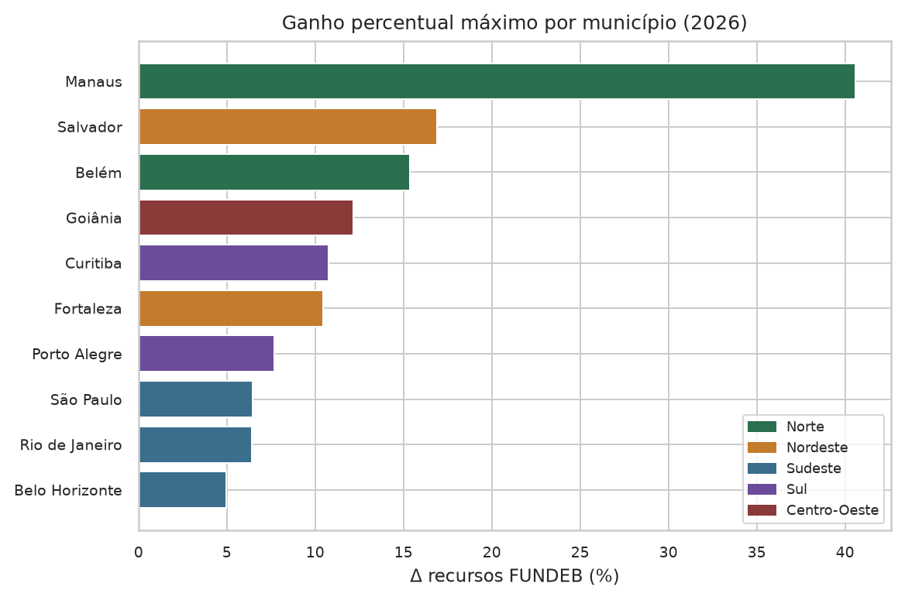

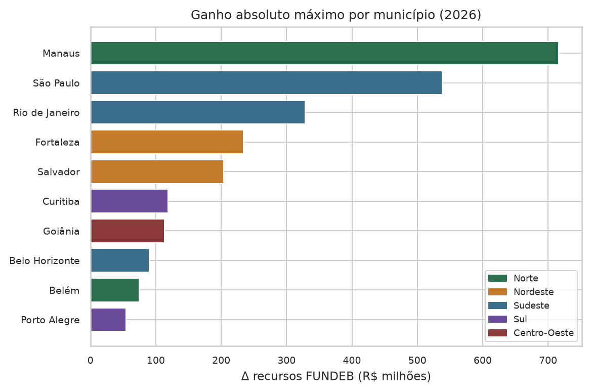

O heatmap município × transição confirma que C domina o Δ% nas capitais da amostra. A e B também são positivas, porém com estoque elegível menor nas redes urbanas grandes. D replica o mecanismo de C nos anos finais, com peso de origem um pouco maior (1,10) e, por isso, ganho unitário menor.

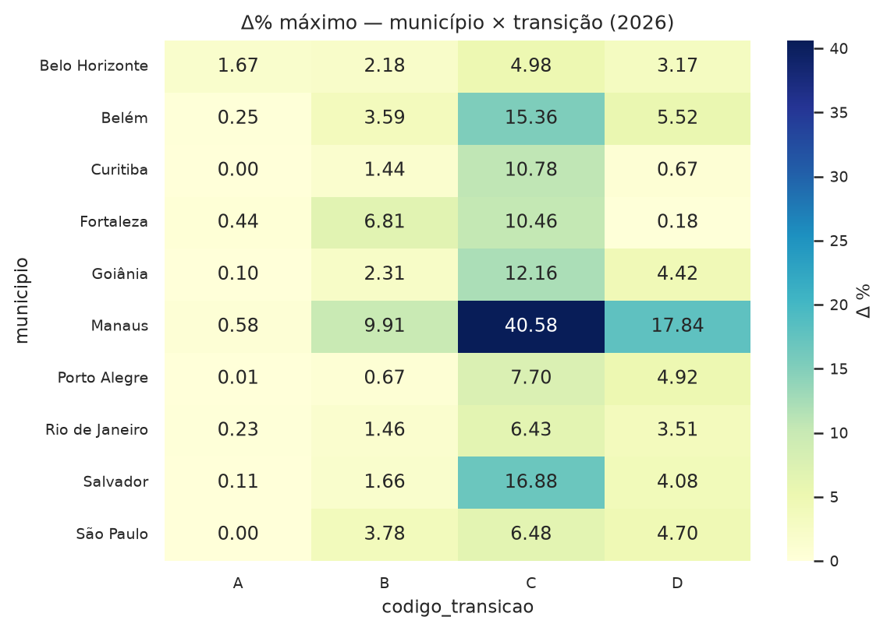

Todos os pontos do melhor cenário situam-se acima da identidade recursos baseline × recursos contrafactuais (Figura 9). A composição, com headcount fixo, desloca o município para um nível mais alto de transferência simulada.

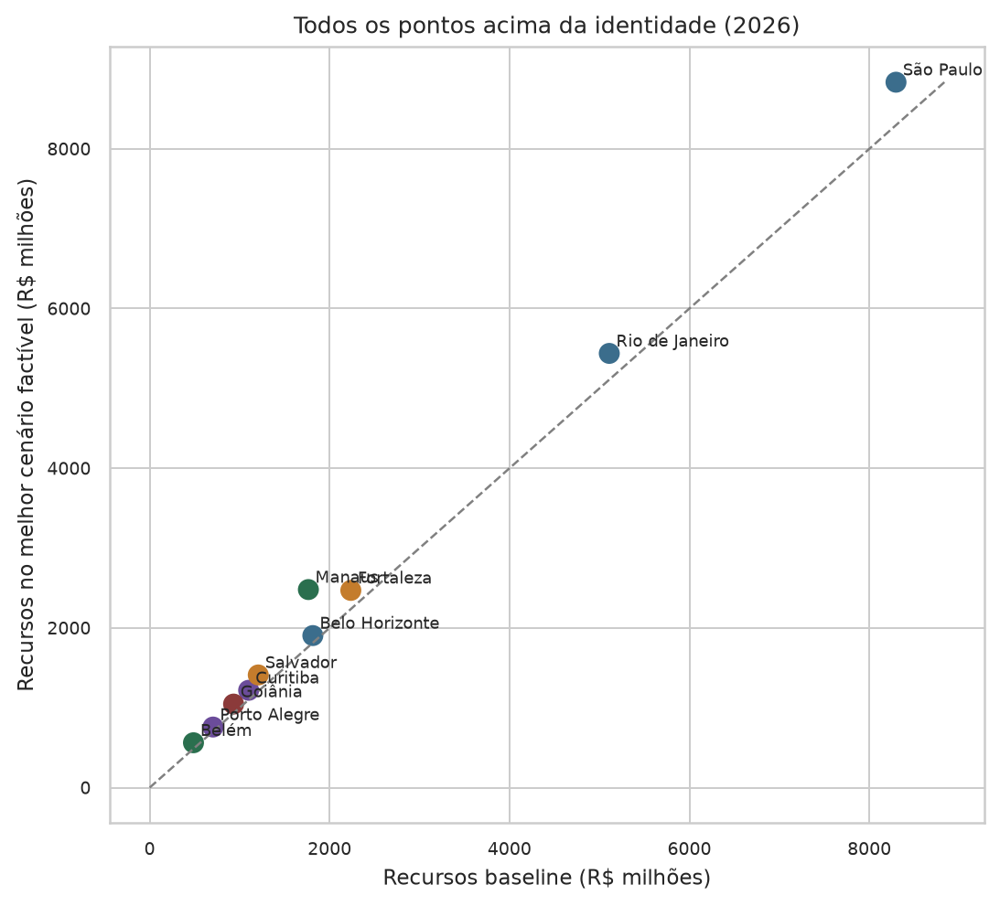

### 3.2 O controle inverso inverte o sinal

O teste decisivo não é o ganho, e sim a assimetria. Ao devolver 100% do estoque de fundamental integral para anos iniciais urbanos (transição C invertida), 10 de 10 municípios perdem recursos. O motor, os pesos, os montantes da União e o total de alunos são os mesmos; muda só o sentido do peso. Fortaleza ilustra a amplitude: o estoque integral da capital cearense é grande, e o Δ% inverso chega a -17,21% quando esse estoque é revertido. Belém, com pouco estoque integral, perde pouco em valor absoluto — o que reforça que o efeito escala com o volume reclassificado, não com um viés fixo do município.

**Tabela 4.** Controle inverso, transição C a 100% (2026): integral → anos iniciais urbanos.

| municipio | uf | regiao | alunos_movidos | delta_r | delta_r_percentual |
| --- | --- | --- | --- | --- | --- |
| Belo Horizonte | MG | Sudeste | 47.398 | R$ -157.358.804,95 | -8,68% |
| Belém | PA | Norte | 493 | R$ -1.530.756,33 | -0,31% |
| Curitiba | PR | Sul | 24.983 | R$ -76.939.842,96 | -6,99% |
| Fortaleza | CE | Nordeste | 121.606 | R$ -384.822.650,03 | -17,21% |
| Goiânia | GO | Centro-Oeste | 9.204 | R$ -27.685.405,15 | -2,97% |
| Manaus | AM | Norte | 13.686 | R$ -41.674.966,74 | -2,36% |
| Porto Alegre | RS | Sul | 5.083 | R$ -19.718.788,77 | -2,80% |
| Rio de Janeiro | RJ | Sudeste | 196.759 | R$ -445.885.351,96 | -8,73% |
| Salvador | BA | Nordeste | 6.228 | R$ -19.095.192,37 | -1,58% |
| São Paulo | SP | Sudeste | 69.956 | R$ -203.812.750,87 | -2,46% |

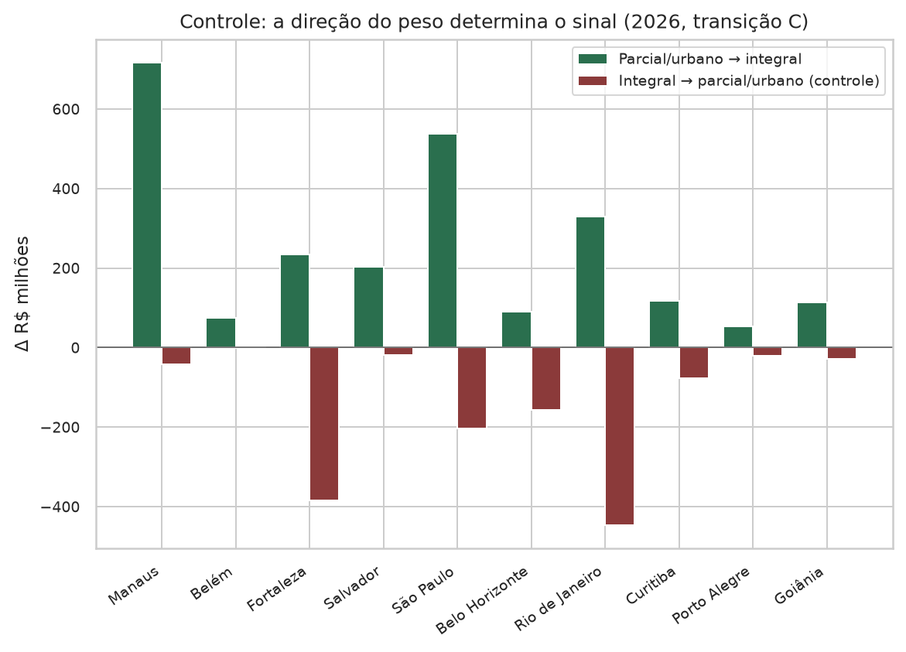

### 3.3 O efeito é aproximadamente linear no percentual convertido

As curvas percentual convertido × ΔR$ da transição C, para os dez municípios, não exibem limiar visível de equalização no intervalo 5–100%. Converter 50% produz cerca de metade do ganho de 100%. A quase-linearidade implica que o resultado não depende de um salto discreto no fundo estadual ou nacional: cada aluno reponderado desloca a fatia do município de modo proporcional, neste recorte e neste intervalo.

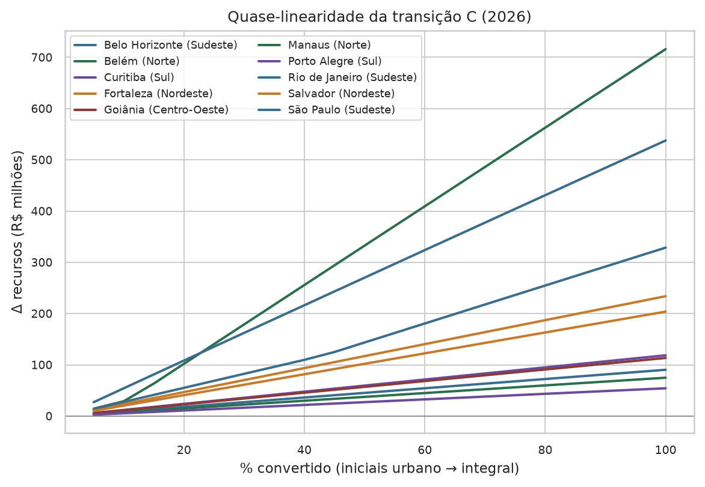

### 3.4 O sinal se repete nas cinco regiões e nos três exercícios

A média regional do Δ% a 100% é positiva nas quatro transições e nas cinco regiões. A transição C é, em geral, a de maior impacto percentual nas capitais, porque o estoque de anos iniciais urbanos é o maior entre as origens factíveis. Creche e pré-escola integral sobem o recebido, mas movem menos alunos.

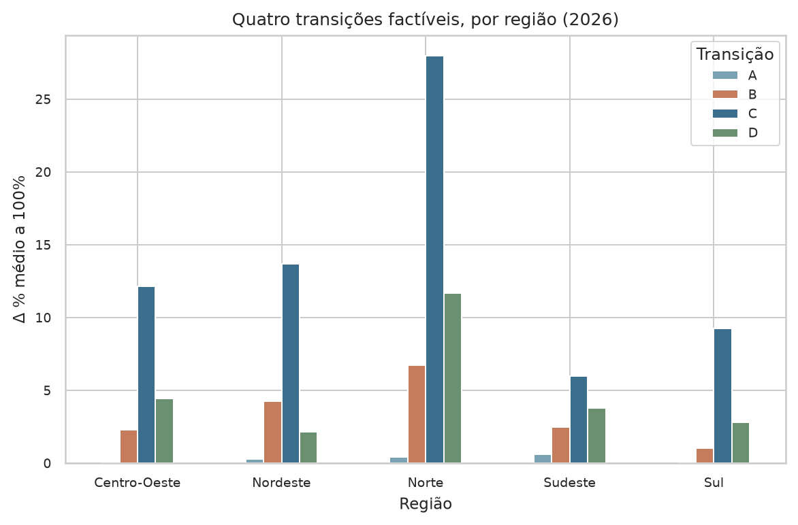

O sinal positivo do melhor cenário reaparece em 2024, 2025 e 2026. A magnitude muda com os pesos (1,40 versus 1,50 no fundamental integral), com o DREC e com os montantes da União — não com a tese. Manaus permanece o extremo percentual nos três anos; as capitais do Sudeste, com fundos estaduais mais altos e sem complemento VAAF, concentram ganhos absolutos grandes e percentuais menores.

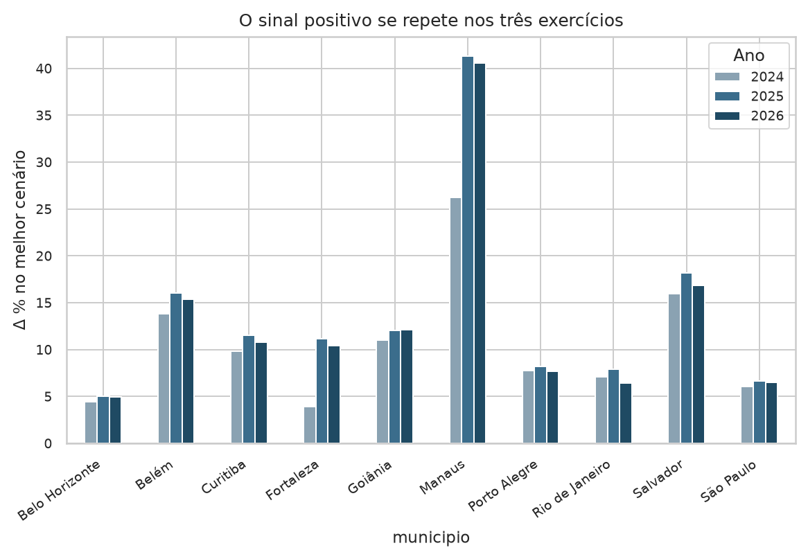

O retorno por aluno convertido no melhor cenário também é heterogêneo: redes em UFs complementadas tendem a capturar mais real por cabeça reponderada, porque o aumento de matrícula ponderada puxa complementação da União, não apenas fatia de um bolo fixo.

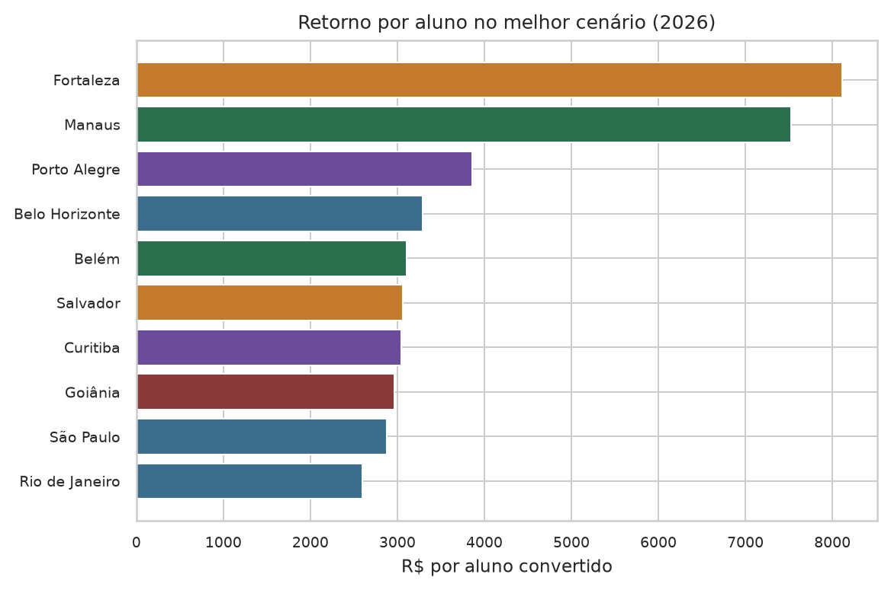

### 3.5 Quem perde na UF — e quando a União entra

Aumentar a matrícula ponderada do alvo reduz a participação relativa dos demais municípios da mesma UF e, em regra, do ente estadual no VAAF. Esse spillover é sistemático: em cada um dos dez experimentos a 100% da melhor transição, o número de municípios prejudicados na UF coincide com o total de demais municípios da unidade (nenhum outro município ganha).

**Tabela 5.** Redistribuição na UF no melhor cenário a 100% (2026). UFs em que a soma estadual cresce: CE, BA, PA, AM, RJ. UFs com soma aproximadamente nula: GO, MG, SP, PR, RS.

| municipio | uf | delta_alvo | delta_demais_mun | delta_ente_estadual | delta_uf_total | n_prejudicados |
| --- | --- | --- | --- | --- | --- | --- |
| Goiânia | GO | R$ 113.408.137,16 | R$ -58.675.748,68 | R$ -54.732.388,61 | R$ -0,13 | 245 |
| Fortaleza | CE | R$ 233.908.847,17 | R$ -22.825.831,94 | R$ -3.304.220,43 | R$ 207.778.794,80 | 183 |
| Salvador | BA | R$ 203.821.242,03 | R$ -31.108.500,44 | R$ -11.510.026,01 | R$ 161.202.715,58 | 416 |
| Belém | PA | R$ 74.834.455,35 | R$ -7.401.587,98 | R$ -2.779.027,34 | R$ 64.653.840,03 | 143 |
| Manaus | AM | R$ 716.056.285,71 | R$ -22.551.723,70 | R$ -8.113.999,41 | R$ 685.390.562,60 | 61 |
| Belo Horizonte | MG | R$ 90.322.346,00 | R$ -48.497.153,16 | R$ -41.825.192,91 | R$ -0,07 | 852 |
| Rio de Janeiro | RJ | R$ 328.711.660,61 | R$ -89.124.071,85 | R$ -50.312.376,70 | R$ 189.275.212,06 | 91 |
| São Paulo | SP | R$ 537.731.377,37 | R$ -250.672.581,98 | R$ -287.058.795,30 | R$ 0,09 | 644 |
| Curitiba | PR | R$ 118.562.362,96 | R$ -61.526.882,02 | R$ -57.035.481,07 | R$ -0,13 | 398 |
| Porto Alegre | RS | R$ 54.239.041,95 | R$ -33.450.011,26 | R$ -20.789.030,66 | R$ 0,03 | 496 |

Dois regimes aparecem com nitidez. No primeiro — Amazonas, Pará, Ceará, Bahia e Rio de Janeiro, neste exercício — a União complementar o fundo. O alvo ganha mais do que os demais e o ente estadual perdem; a soma da UF sobe. O canal dominante do ganho municipal adicional é o complemento VAAT e/ou VAAF, não apenas a redistribuição do ICMS educacional estadual. No segundo regime — São Paulo, Minas Gerais, Paraná, Rio Grande do Sul e Goiás — o Δ da UF é da ordem de centavos. O ganho do alvo é quase integralmente a perda dos demais municípios mais a perda do ente estadual. É um jogo de soma zero dentro do estado: a composição muda quem come o bolo, não o tamanho do bolo.

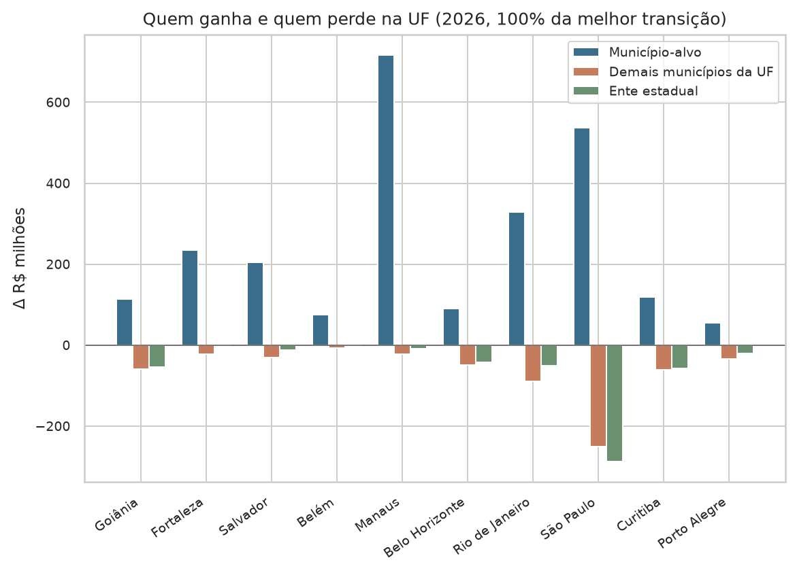

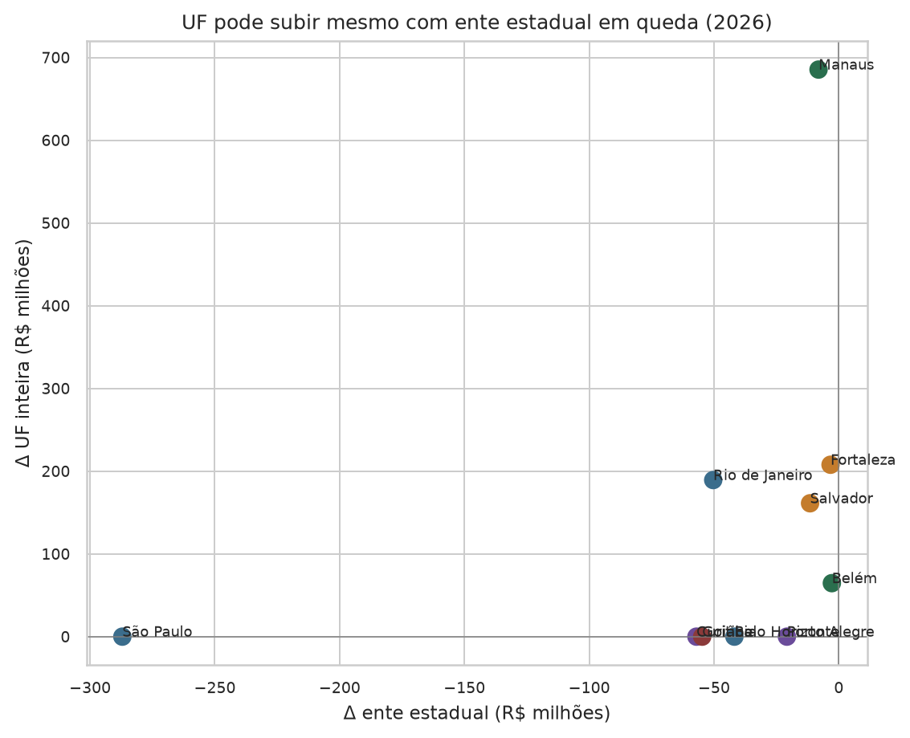

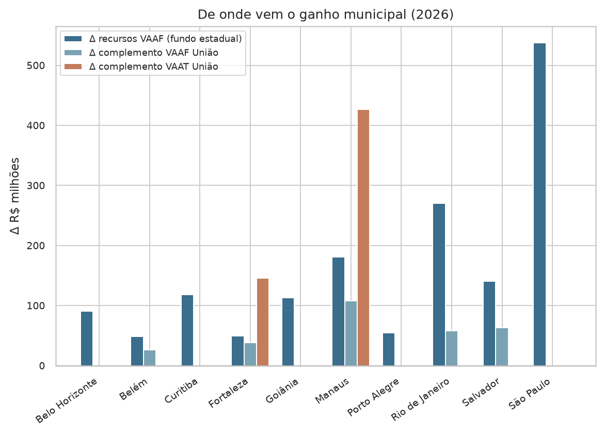

## 4 Discussão

A evidência computacional sustenta a tese em três camadas. Primeiro, no município: a composição altera o recebido, e o sinal é o da mudança de peso. Isso vale nas cinco regiões, em 10 estados e em três exercícios. Segundo, no estado: o ente estadual e os demais municípios absorvem o deslocamento de fatia. Terceiro, na Federação: só há recurso novo na UF se a União complementar. A distinção entre UFs complementadas e UFs auto-suficientes no VAAF é, portanto, parte da tese — não um resíduo.

O resultado não autoriza interpretar tempo integral como alavanca fiscal. A vaga integral custa mais em pessoal, alimentação e infraestrutura; o ΔR$ simulado é o lado da receita do fundo, não o resultado líquido da política. Tampouco se deve ler o controle inverso como argumento contra a jornada estendida: ele apenas demonstra que o motor é simétrico no peso. A formulação correta é de incentivo implícito. Gestores que maximizassem o repasse, ignorando custo e pedagogia, teriam motivo para inflar modalidades de peso alto. A ponderação existe precisamente para financiar etapas mais caras; o risco é o uso da classificação como instrumento de arrecadação.

Em UFs sem complemento VAAF, o incentivo é ainda mais redistributivo: o município que repondera extrai recurso dos vizinhos e da rede estadual. Em UFs complementadas, parte do ganho é externalizada para a União. Os dois desenhos produzem o mesmo sinal municipal e implicações federativas opostas.

## 5 Limitações

A amostra é de capitais e grandes redes. A direção do efeito — peso maior, mais recurso municipal — deve se repetir em municípios menores; a magnitude e o peso relativo do VAAT não. Não se estima o custo da vaga, o efeito sobre aprendizagem, nem a factibilidade administrativa de converter 100% de uma etapa. Os ponderadores NSE/DREC e os fatores máximo/mínimo foram fixados no cenário de referência; outras combinações de parâmetros podem alterar a magnitude, não necessariamente o sinal. O estudo não cobre a reclassificação entre etapas de pesos iguais, nem a criação de matrículas novas. Por fim, o motor reproduz a regra vigente nos microdados de cada exercício; mudanças normativas posteriores requerem nova simulação.

## 6 Conclusão

Alterações contrafactuais na composição das matrículas, com o total de alunos constante, modificam os recursos simulados do FUNDEB do município porque alteram a matrícula ponderada e, com ela, a participação no fundo estadual (VAAF) e na equalização nacional (VAAT). O sinal do efeito segue o sinal da mudança de peso: parcial ou urbano rumo a integral aumenta o recebido do alvo; o inverso o reduz. O ente estadual e os demais municípios da UF absorvem parte do ajuste. A UF só cresce de forma material se a União complementar mais. Esse padrão reproduz-se em 10 municípios, 10 estados e cinco regiões, nos exercícios 2024, 2025 e 2026.

## Referências

- Brasil. Lei nº 14.113, de 25 de dezembro de 2020. Regulamenta o Fundo de Manutenção e Desenvolvimento da Educação Básica e de Valorização dos Profissionais da Educação (Fundeb).
- Brasil. Lei nº 14.276, de 27 de dezembro de 2021. Altera a Lei nº 14.113/2020.
- Instituto Federal do Ceará. Simulador FUNDEB v2. Motor `simula_fundeb` e dataset dos exercícios 2024–2026. Reprodução deste artigo: `python -m analises.fundeb_regioes.run`.
